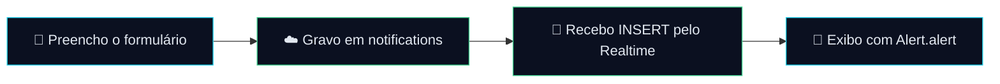

<div align="center">
  
</div>

<div align="center">

# E N G C O M P　A L E R T

### `MOBILE APPLICATION • REALTIME EVENTS • DATABASE CONNECTION`

**Conecto eventos do banco de dados à tela do celular.**


`MOBILE_009` · `DESENVOLVIMENTO MOBILE` · `PROJETO ACADÊMICO`

[Visão geral](#visao-geral) · [Arquitetura](#arquitetura) · [Configuração](#configuracao) · [Execução](#execucao) · [Testes](#testes)

</div>

---

<a id="visao-geral"></a>

## `ENGCOMP // VISÃO GERAL`

Neste projeto, sigo o material **MOBILE_009** para estudar a comunicação em
tempo real entre um aplicativo e um banco de dados na nuvem. Uso **React Native
com Expo** para a interface e **Supabase** para armazenar os avisos e receber
eventos de novas inserções.

Digito um título e uma mensagem, envio o aviso e acompanho sua chegada nos
aplicativos abertos e conectados ao mesmo banco, sem atualizar a tela manualmente.

| Recurso | Como utilizo no projeto |
| :--- | :--- |
| 📡 Realtime | Escuto novas inserções na tabela `notifications`. |
| ✍️ Formulário | Preencho título e mensagem e valido os campos antes do envio. |
| 💬 Alertas | Exibo o conteúdo recebido com `Alert.alert`. |
| ⏳ Carregamento | Substituo o botão por um indicador enquanto aguardo a gravação. |
| 🟢 Conexão | Mostro na tela a confirmação de inscrição no canal. |

## `SYSTEM // STATUS`

| Módulo | Estado que registro |
| :--- | :---: |
| Interface e formulário | `● IMPLEMENTADO` |
| Escuta de eventos INSERT | `● IMPLEMENTADA` |
| Alertas em tela | `● IMPLEMENTADOS` |
| URL e chave do Supabase | `◉ CONFIGURAÇÃO PENDENTE` |
| Integração nos celulares | `◉ TESTE PENDENTE` |

> **CONNECTION STATUS:** mantenho os valores de exemplo da conexão. Ainda preciso
> configurar o Supabase e validar o envio e o recebimento nos celulares.

<a id="arquitetura"></a>

## `REALTIME CORE // FLUXO DE EVENTOS`

Organizo o fluxo em quatro etapas: **preencho → gravo → recebo o evento → exibo**.



<details>
<summary><strong>Como organizo o estado e a escuta no código</strong></summary>

- Com `useState`, guardo o título, a mensagem, o carregamento e o status da conexão.
- Com `useEffect`, inicio a inscrição no Realtime quando monto a tela.
- Escuto apenas `INSERT`, que representa a inclusão de um registro. Não trato alterações ou exclusões neste exemplo.
- Quando recebo `SUBSCRIBED`, atualizo o status exibido na interface.
- Ao desmontar a tela, removo o canal para encerrar a escuta.

Antes do envio, uso `trim()` para retirar espaços das extremidades. Se algum
campo estiver vazio, interrompo a operação. Depois da gravação, verifico o erro
devolvido pelo Supabase; quando não há erro, confirmo o envio e limpo o formulário.

</details>

<a id="estrutura"></a>

## `ARCHITECTURE // ESTRUTURA DO SISTEMA`

```text
projnot/
├── docs/                          # Reúno o banner e o material MOBILE_009
├── assets/                         # Mantenho as imagens do aplicativo
├── src/
│   ├── helper/
│   │   └── notificationsHelper.js  # Reúno a exibição dos alertas
│   └── services/
│       └── supabase.js             # Centralizo a conexão com o banco
├── App.js                         # Organizo a tela, o envio e a escuta
├── index.js                       # Registro o componente principal
├── app.json                       # Configuro o aplicativo no Expo
├── package.json                   # Defino dependências e comandos
├── package-lock.json              # Registro as versões instaladas
├── .gitignore                     # Excluo arquivos locais do versionamento
├── LICENSE                        # Preservo a licença do modelo Expo
└── README.md                      # Documento o projeto
```

<a id="configuracao"></a>

## `DATABASE CONFIG // SUPABASE`

### Preparo minha tabela

No Supabase, crio a tabela **`notifications`** e habilito o **Realtime** para ela.

| Coluna | Tipo | Como configuro |
| :--- | :--- | :--- |
| `id` | `int8` | Defino como chave primária com incremento automático. |
| `title` | `text` | Armazeno o título do aviso. |
| `body` | `text` | Armazeno a mensagem do aviso. |
| `created_at` | timestamp | Defino `now()` como valor padrão para registrar a inclusão. |

### Configuro o acesso da atividade

Mantenho o **RLS habilitado** e reproduzo a política da página 11 do material:

| Opção | Valor que utilizo |
| :--- | :--- |
| Nome | `Enabled read/write for all users` |
| Comportamento | `Permissive` |
| Comando | `ALL` |
| Papel | `public` |
| Expressão USING | `true` |
| Expressão WITH CHECK | `true` |

Com essa política, permito acesso amplo à tabela no exemplo da aula. Não separo
os usuários por autenticação nesta versão.

### Conecto meu aplicativo

Em [`src/services/supabase.js`](src/services/supabase.js), substituo os dois
valores de exemplo pelos dados do meu projeto:

```js
const supabaseUrl = 'SUA_URL_DO_SUPABASE';
const supabaseKey = 'SUA_CHAVE_ANON_PUBLICA';
```

Uso a **chave anon pública** no aplicativo. Mantenho a chave secreta de
administração fora do código. Nesta implementação, preencho as constantes
diretamente; ainda não faço a leitura de um arquivo `.env`.

<a id="execucao"></a>

## `BOOT SEQUENCE // EXECUÇÃO LOCAL`

Para executar, preciso de **Node.js com npm**, **Expo Go no celular** e do
**projeto Supabase configurado**. A partir da pasta que contém `projnot`, entro
no aplicativo e instalo as dependências:

```bash
cd projnot
npm install
```

Depois, inicio o Expo com o comando usado na aula:

```bash
npx expo start --tunnel
```

Abro o Expo Go, escaneio o QR Code e mantenho o aplicativo aberto. Aguardo o
status **🟢 Conectado e Escutando Avisos** antes de enviar minha primeira mensagem.

<a id="testes"></a>

## `DIAGNOSTICS // ROTEIRO DE TESTES`

Uso este roteiro para conferir o comportamento após configurar a conexão:

- [ ] Tento enviar com os campos vazios e verifico o alerta de preenchimento obrigatório.
- [ ] Preencho apenas espaços e verifico se a validação também impede o envio.
- [ ] Envio título e mensagem e confiro a inclusão na tabela `notifications`.
- [ ] Verifico a confirmação de envio e a limpeza dos campos.
- [ ] Abro o aplicativo em dois celulares conectados ao mesmo projeto Supabase.
- [ ] Envio um aviso por um celular e verifico sua chegada no outro sem atualizar a tela.

Ainda não marco esses testes como concluídos: preciso validar a integração
com uma conexão real e os dispositivos.

<a id="escopo"></a>

## `SYSTEM // ESCOPO DA VERSÃO`

Uso **`Alert.alert`**, uma caixa de diálogo dentro do aplicativo. Para receber
os eventos e mostrar os avisos, mantenho o app aberto e conectado.

Não implemento push nem recebimento em segundo plano. Por isso, na função
`registerForLocalNotificationsAsync`, retorno `true` sem pedir permissão de
notificação ao sistema operacional.

<a id="referencias"></a>

## `MOBILE_009 // REFERÊNCIAS`

Uso o [material MOBILE_009](docs/MOBILE_009.pdf) como base da atividade:

- Na **página 14**, consulto a configuração da conexão.
- Na **página 17**, consulto o helper de alertas.
- Nas **páginas 20 a 26**, acompanho a implementação da tela.

Mantenho a lógica e a interface do exemplo e explico os blocos nos comentários
do código. Preservo também a [licença MIT do modelo Expo](LICENSE).

---

<div align="center">

## `ENGCOMP // REALTIME SYSTEM`

**Gilberto Correa**

Análise e Desenvolvimento de Sistemas<br />
FATEC

[Meu GitHub](https://github.com/gilbertocorrea-cmd)

`REACT NATIVE` • `EXPO` • `SUPABASE` • `REALTIME`

Exploro a conexão entre interface, dados e eventos em tempo real.

**◉ INTEGRAÇÃO: CONFIGURAÇÃO PENDENTE**

</div>
